# Datadog key lifecycle on AWS: find, rotate, remove

Rotating a Datadog API key is one API call. The hard part is everything that still holds the old key: an AMI with the key baked in, an ECS task that read it at deploy time, a Lambda, a parameter someone copied years ago. This repo is a working lab that answers three questions for one AWS account, built so the same modules can run per account at scale:

1. **Find.** Where do copies of the Datadog key live, and which of them are still live? (`src/census.py`)
2. **Rotate.** Rotate the key with AWS Secrets Manager managed external secrets, and check first that nothing still uses the key that will be revoked. (`terraform/modules/rotation`, `terraform/modules/safe-to-rotate`)
3. **Remove.** Show which delivery patterns survive a rotation and which go dark, then fix the ones that break. (EC2, Lambda, ECS Fargate consumers)

Status: lab build complete. Tested on Datadog EU (`datadoghq.eu`), AWS `eu-west-1`.

## What the lab showed

Each consumer was tested across real rotations. Results from the lab:

| Consumer | How it gets the key | After rotation |
|---|---|---|
| EC2, AMI-baked | key written into `datadog.yaml` in the image | Goes dark when the key is revoked (two rotations later). Only a rebuild fixes it. |
| EC2, AMI-ref | `api_key: ENC[...]` read from Secrets Manager by the Agent secrets backend | No gap |
| Lambda | Datadog extension reads the secret ARN | No gap |
| ECS A | task definition `secrets` (read once at deploy) | 403 from Datadog while ECS still shows the task as running. Fixed by the redeploy hook. |
| ECS B | Agent secrets backend with refresh on 403 | Recovers by itself within about 1 second of the first 403 |

Other findings:

- Datadog cannot see a rejected key. A CloudWatch Logs metric filter on `API Key invalid` alarmed in about 2 minutes; the Datadog no-data monitor needed about 10.
- Datadog reports `date_last_used` rounded down to the hour, so "idle" checks need a margin (120 minutes in the lab).
- `AWSPENDING` can be left on the current version, after repeated `rotate-secret` calls or after a failed rotation that AWS retried. The safe-to-rotate check holds while any version carries `AWSPENDING`.

## Architecture

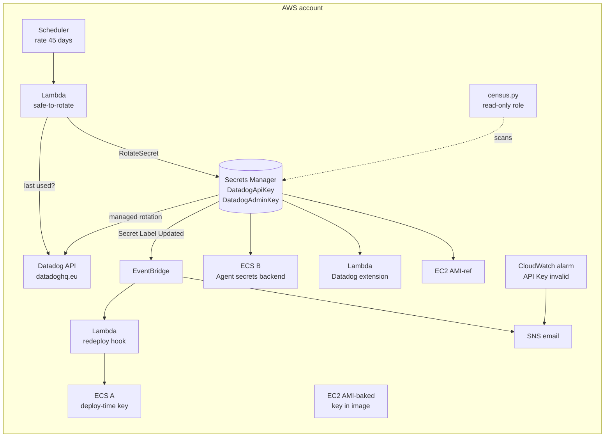

Detailed diagram with AWS icons:

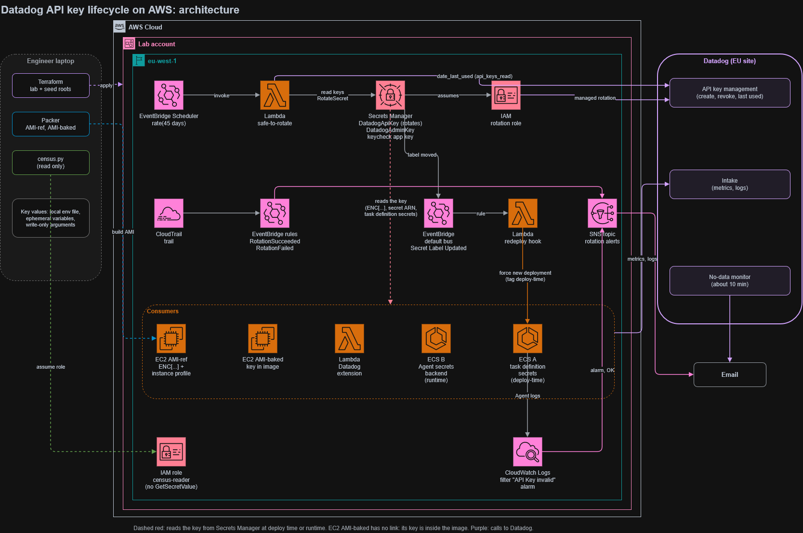

Source: [docs/architecture.drawio](docs/architecture.drawio) (open in app.diagrams.net).

Docs: [scale design](docs/scale.md), [security review](docs/security-review.md).

## How it works

**Census: find the copies first.** `src/census.py` scans an account region by region and sorts every place it finds a Datadog key into four classes:

| Class | Meaning | After rotation |
|---|---|---|
| COPY | The key value itself sits in the resource (SSM parameter, Lambda env var, launch template user data) | Breaks when that key is revoked |
| DEPLOY-TIME | The resource points at the secret but reads it once, at start (ECS task definition `secrets`) | Survives only if redeployed after each rotation |
| REFERENCE | The consumer reads the secret at runtime (`ENC[...]`, secret ARN) | Survives |
| HIDDEN | AWS will not show the value (CloudFormation NoEcho) | Check by hand |

The scan runs through a read-only role that cannot read secret values, and it prints only the last 4 characters of a key.

**Managed rotation.** Two secrets: the admin secret holds the service account credentials that Secrets Manager uses to call Datadog, and the API key secret holds the key every consumer reads. On each rotation Datadog creates a new key, AWSCURRENT moves to it, the old current key becomes AWSPREVIOUS and stays valid, and the key from two rotations back is revoked. No rotation Lambda is involved.

**Safe-to-rotate.** Before a rotation, a Lambda checks the key that the next rotation will revoke (AWSPREVIOUS). It holds the rotation and sends an email if a previous rotation is unfinished (AWSPENDING set) or if that key was used within the idle limit. It runs every 45 days; the AWS schedule of 90 days stays as a backstop, so a hold cannot last forever.

**Redeploy hook.** When AWSCURRENT moves, Secrets Manager emits the native EventBridge event "Secret Label Updated" (no CloudTrail trail needed). A Lambda force-deploys the ECS services in the cluster tagged `DatadogKeyDelivery=deploy-time`, so their new tasks start with the new key long before the old key is revoked.

**Monitoring from both sides.** A CloudWatch Logs metric filter on `API Key invalid` in the Agent logs drives an alarm that sees the cause. A Datadog no-data monitor sees the effect: data that stopped arriving.

## FAQ

**Census only shows the last 4 characters. How does it know a copy is still live?**
With `--datadog-status` it reads the org's API key list, which returns each key's last 4 characters and metadata but never the key value. A copy whose last 4 match an active key is LIVE. A copy with no match was already revoked and is cleanup, not an outage risk.

**Which key does a rotation revoke?**
The one from two rotations back. After rotation N, AWSCURRENT holds key N, AWSPREVIOUS holds key N-1 (still valid), and key N-2 is revoked. Every consumer gets one full rotation period to pick up the new key.

**Why does the safe-to-rotate check not call Datadog with the old key?**
Any call made with a key can count as use of that key. Calling with AWSPREVIOUS to ask whether AWSPREVIOUS is idle would make it look busy. The check calls the key list endpoint with the current key and an application key that has only `api_keys_read`.

**Why is the idle limit 120 minutes in the lab?**
Datadog reports `date_last_used` rounded down to the hour. A key used at 10:59 shows 10:00, so a limit under an hour can misjudge. Production uses 1440 minutes (one day).

**ECS shows the task as running. What is wrong?**
ECS only knows the container process is alive. With task definition `secrets`, the key is injected once when the task starts, so a running task keeps the old key after a rotation. Once that key is revoked, the Agent gets 403 from Datadog and drops data while ECS still reports `running`. The redeploy hook starts new tasks right after each rotation, so this never happens.

**Why does ECS B survive without the hook?**
Its Agent reads the key at runtime through its secrets backend and refreshes it on a timer. When Datadog returns 403, the Agent refreshes the secret immediately and continues with the new key. In the lab this took under a second.

**Why both a CloudWatch alarm and a Datadog monitor?**
Datadog cannot see data it rejected; it only notices that data stopped. The Agent log on the AWS side shows the cause, the 403. In the lab the CloudWatch alarm fired in about 2 minutes and the Datadog no-data monitor detected the gap in about 10. They also cover each other: the log alarm misses an Agent that stops without logging, and the no-data monitor says data stopped but not why.

**Why not rebuild the AMI-baked image after each rotation?**
That would copy a live key into an image again, and every launch from that image carries it. The fix is a key-free image (AMI-ref) that reads the secret at runtime.

**What if a rotation fails?**
Secrets Manager retries it. In the lab, a rotation broken on purpose (rotation role policy removed) completed on a retry after the policy was restored, and left AWSPENDING on the new current version. The safe-to-rotate check held the next rotation until the label was removed with `aws secretsmanager update-secret-version-stage --remove-from-version-id`.

## Repo layout

```text
packer/                 AMI-ref (no key) and AMI-baked (anti-pattern) images
src/census.py           finds key copies across regions; --datadog-status marks LIVE copies
scripts/                load-secrets.ps1 (Datadog values into TF_VAR_*), check-dd-keys.ps1
terraform/modules/      datadog-secrets, rotation, rotation-alerts, cloudtrail, census-reader,
                        consumer-access, redeploy-hook, safe-to-rotate
terraform/envs/lab/     the lab: wires the modules, network, hosts, Lambda, ECS, monitoring
terraform/envs/seed/    planted key copies for the census test (destroy after use)
```

## Prerequisites and costs

Tools (versions used in the lab; Windows PowerShell 5.1):

| Tool | Version |
|---|---|
| Terraform | 1.15 or later (providers: aws `~> 6.68`, datadog `~> 4.25`, archive `~> 2.8`) |
| Packer | 1.16 or later (amazon plugin `~> 1.8`) |
| AWS CLI | v2, with IAM Identity Center (SSO) |
| Python | 3.13 (python.org installer, `python` on PATH), `boto3` from `requirements.txt` in a virtual environment |
| gitleaks | 8.30.1 (pre-commit hook) |

Accounts:

- An AWS account you can delete things in, with two SSO profiles: `poc02` (apply) and `poc02-ro` (read-only, for plan).
- A Datadog org (a trial works). In Datadog create a service account and these keys. You only keep the values in a local file outside the repo.

| Value | What it is |
|---|---|
| `DD_ADMIN_API_KEY`, `DD_ADMIN_API_KEY_ID` | API key for the admin secret that Secrets Manager uses to call Datadog |
| `DD_ADMIN_APP_KEY`, `DD_ADMIN_APP_KEY_ID` | Application key of the service account, used by the managed rotation |
| `DD_SERVICE_ACCOUNT_ID` | The service account ID |
| `DD_CONSUMER_API_KEY`, `DD_CONSUMER_API_KEY_ID` | The API key the Agents use. This is the key that rotates. |
| `DD_KEYCHECK_APP_KEY` | Application key with only `api_keys_read`, for the safe-to-rotate check |
| `DD_MONITORS_APP_KEY` | Application key with only `monitors_read` and `monitors_write`, for the Terraform Datadog provider |

Costs (AWS, `eu-west-1`). Everything that runs continuously is off by default.

| Item | Cost | Guardrail |
|---|---|---|
| Secrets Manager | $0.40 per secret per month, $0.05 per 10,000 API calls ([pricing](https://aws.amazon.com/secrets-manager/pricing/)) | 3 secrets |
| EC2 t3.micro x2 | per hour while on | `hosts_enabled = false` by default |
| ECS Fargate 0.25 vCPU / 0.5 GB x2 | per hour while on | `ecs_enabled = false` by default |
| CloudTrail | first management trail copy is free; S3 storage | one trail |
| Lambda, EventBridge, SNS, CloudWatch | free tier at lab volume | |

Set an AWS budget alert before you start. Run the teardown at the end.

## Quickstart

All commands are PowerShell. Run them from the repo root unless a step says otherwise. In a new PowerShell window, activate the virtual environment again (`.\.venv\Scripts\Activate.ps1`) and reload the Datadog values (step 3).

### 1. Clone and install

```powershell
git clone https://github.com/g2ai/datadog-key-lifecycle-aws.git
cd datadog-key-lifecycle-aws
python -m venv .venv
.\.venv\Scripts\Activate.ps1
python -m pip install -r requirements.txt
```

### 2. Sign in to AWS

```powershell
aws sso login --profile poc02
aws sts get-caller-identity --profile poc02-ro
```

### 3. Load the Datadog values

Copy `.env.example` to `$HOME\poc-secrets\poc-02.env` (outside the repo) and fill in the values from the table above. Then load them into this PowerShell window only. Note the leading dot.

```powershell
. .\scripts\load-secrets.ps1
```

Every line must say `ok`. The script never prints a value.

### 4. Set the alert email

```powershell
Copy-Item terraform\envs\lab\terraform.tfvars.example terraform\envs\lab\terraform.tfvars
notepad terraform\envs\lab\terraform.tfvars
```

`terraform.tfvars` is git-ignored.

### 5. Build the AMI (only if you want the EC2 hosts)

The base image is pinned in `packer/base-ami.auto.pkrvars.hcl`. Update it from the public SSM parameter when you want a newer base:

```powershell
aws ssm get-parameter --name /aws/service/ami-amazon-linux-latest/al2023-ami-kernel-default-x86_64 --query Parameter.Value --output text --profile poc02-ro --region eu-west-1
```

```powershell
cd packer
packer init .
packer validate .
packer build -only="ref.*" .
cd ..
```

The AMI-baked image writes a live key into the image. Build it only to repeat the "goes dark" test, and deregister it afterwards.

### 6. Apply the lab

```powershell
cd terraform\envs\lab
terraform init
terraform plan -out lab.tfplan
terraform apply -var aws_profile=poc02 lab.tfplan
```

Confirm the SNS subscription email. The base apply creates the secrets, the rotation role, alerts, the census reader role, the Lambda consumer, the safe-to-rotate check (schedule disabled in the lab) and the monitoring. No hosts and no ECS tasks run yet.

Turn consumers on only for a test session:

```powershell
terraform apply -var aws_profile=poc02 -var hosts_enabled=true -var ecs_enabled=true
```

### 7. Find key copies

```powershell
cd ..\..\..
$role = terraform -chdir=terraform\envs\lab output -raw census_reader_role_arn
python src\census.py --profile poc02 --role-arn $role --regions eu-west-1 us-east-1
```

The `poc02` profile is used only to assume the census role, which is read-only. The `ReadOnlyAccess` permission set cannot call `sts:AssumeRole`. Add `--datadog-status` to mark each copy LIVE or not live (needs `DD_API_KEY` and `DD_APP_KEY` with `api_keys_read` in the environment). The report goes to `census-output\`.

### 8. Check before rotating (dry run)

```powershell
'{"dry_run": true}' | Set-Content -Encoding ascii dryrun.json
aws lambda invoke --function-name poc-02-safe-to-rotate --payload fileb://dryrun.json --profile poc02 --region eu-west-1 out.json
Get-Content out.json
```

`ROTATE` means the key that would be revoked has been idle longer than `keycheck_idle_minutes`. `HOLD` sends an email with the reason.

### 9. Rotate

```powershell
aws secretsmanager rotate-secret --secret-id poc-02/datadog-api-key --profile poc02 --region eu-west-1
```

Run it once. Rotation is asynchronous: wait for the success email before you check anything.

```powershell
aws secretsmanager list-secret-version-ids --secret-id poc-02/datadog-api-key --profile poc02 --region eu-west-1
```

## Demo scenarios

1. **Baked key goes dark.** Hosts on, rotate twice. The AMI-baked host stops reporting about a minute after the second rotation revokes its key. The AMI-ref host has no gap.
2. **ECS lies.** Disable the redeploy hook rule, rotate twice. ECS A shows `running: 1` while its Agent log fills with `API Key invalid`. The CloudWatch alarm fires in about 2 minutes. Enable the rule again (`terraform apply` restores it).
3. **Self-healing Agent.** ECS B gets one 403, refreshes the secret and carries on.
4. **Hold the rotation.** Use the old key from any client, then run the dry run. The check holds and names the key by its last 4 characters.
5. **Find the copies.** Apply `terraform/envs/seed` (planted copies in SSM, Lambda env, launch templates, ECS, CloudFormation), run the census, destroy the seed.

## Teardown

```powershell
cd terraform\envs\lab
terraform apply -var aws_profile=poc02 -var hosts_enabled=false -var ecs_enabled=false
terraform destroy -var aws_profile=poc02
```

Then deregister the AMIs and delete their snapshots, revoke the Datadog keys and application keys, and delete the service account. Secrets are deleted with a 7-day recovery window, so the same secret names cannot be reused for 7 days unless you delete them with `--force-delete-without-recovery`.

## Screenshots

Account IDs, ARNs and email addresses are masked.

**Find.** Census sweep over a seeded account: 7 copies of a key, 4 references, 1 hidden value.

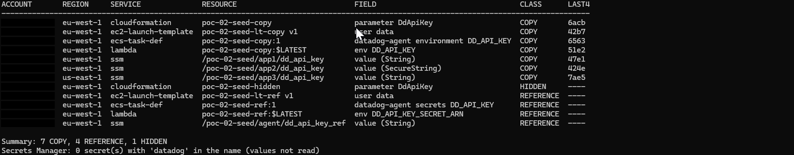

**ECS A after the key was revoked.** ECS reports the service as running while the Agent logs `API Key invalid (403)` and drops every payload.

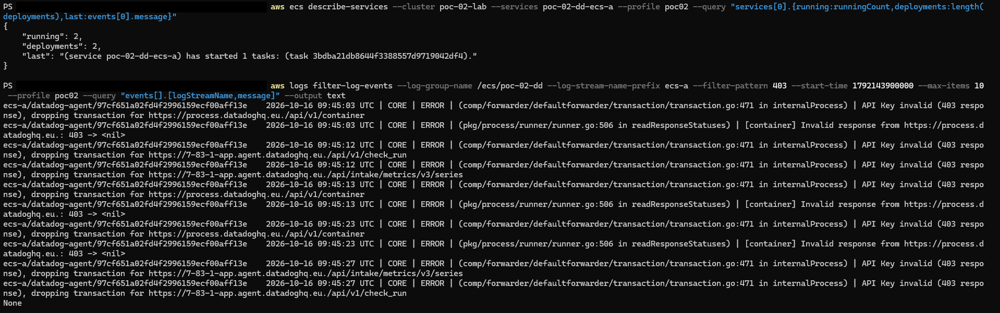

**ECS A gap and recovery.** No data from ECS A after the revoke; data returns after a forced redeployment. ECS B carries on.

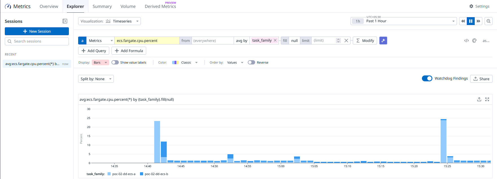

**Redeploy hook.** Each AWSCURRENT change redeploys the service tagged deploy-time (ECS A) and skips the runtime reader (ECS B).

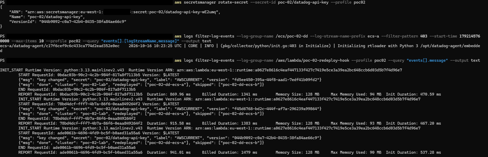

**ECS B.** One 403, then the Agent refreshes the secret and continues.

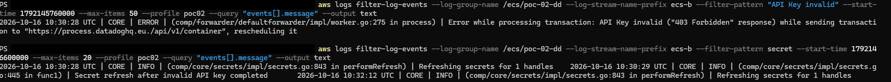

**Safe-to-rotate holds.** The key about to be revoked was used 14 minutes ago, and in a second case a previous rotation was unfinished.

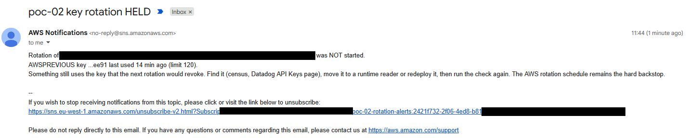

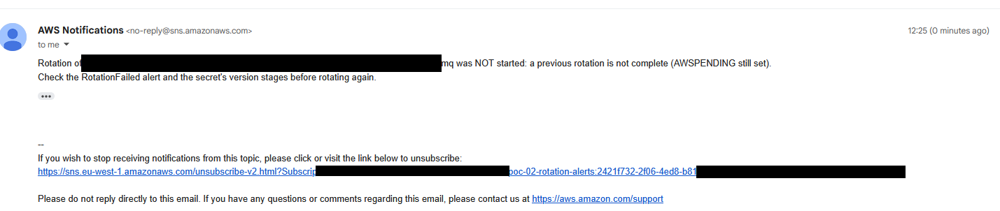

**Detection from both sides.** CloudWatch alarm on `API Key invalid` and the Datadog no-data monitor.

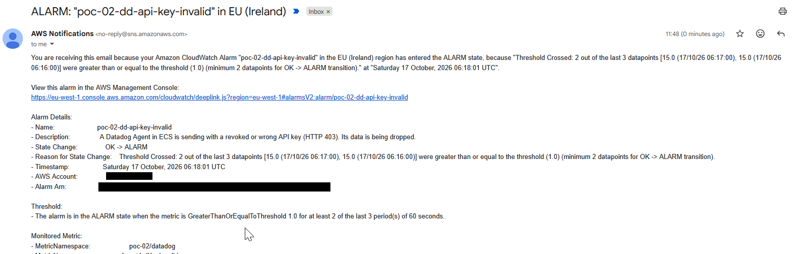

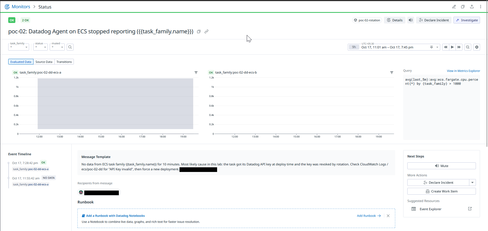

## Limitations

- One account and one region for the lab. The multi-account design is in [docs/scale.md](docs/scale.md) and is not built.
- Datadog EU site only is tested. Other sites need `api_url` and `--dd-site` changes.
- Resource names use the fixed prefix `poc-02`, so one copy of the lab per account.
- Terraform state is local.
- The Datadog no-data monitor detected the outage but its email was not delivered in the lab. The CloudWatch alarm is the primary alert.
- Datadog Workload Identity Federation (keyless Agent auth) is noted as a next step, not built.

## References

- AWS Secrets Manager, managed external secrets partners: https://docs.aws.amazon.com/secretsmanager/latest/userguide/mes-partners.html
- AWS announcement, managed external secrets for Datadog and Snowflake (May 2026): https://aws.amazon.com/about-aws/whats-new/2026/05/secrets-manager-managed-external-secrets-datadog-snowflake/
- Datadog Agent secrets management: https://docs.datadoghq.com/agent/configuration/secrets-management/
- Datadog Lambda extension configuration: https://docs.datadoghq.com/serverless/guide/agent_configuration/
- AWS Secrets Manager pricing: https://aws.amazon.com/secrets-manager/pricing/

## License

See [LICENSE](LICENSE).
